# FO:TEN (포텐)

> E-9 체류기간 4년(**FO**ur) 10개월(**TEN**)을 더 큰 포텐셜로 바꾼다

E-9 이주노동자의 금융 목표와 소비패턴을 분석해, 체류기간 내 목표 달성을 위한 맞춤형 저축 전략을 대화형으로 제안하는 AI 자산관리 서비스입니다.

2026 KB IT's Your Life 해커톤 · 세잎클로버

<p align="center">
  
  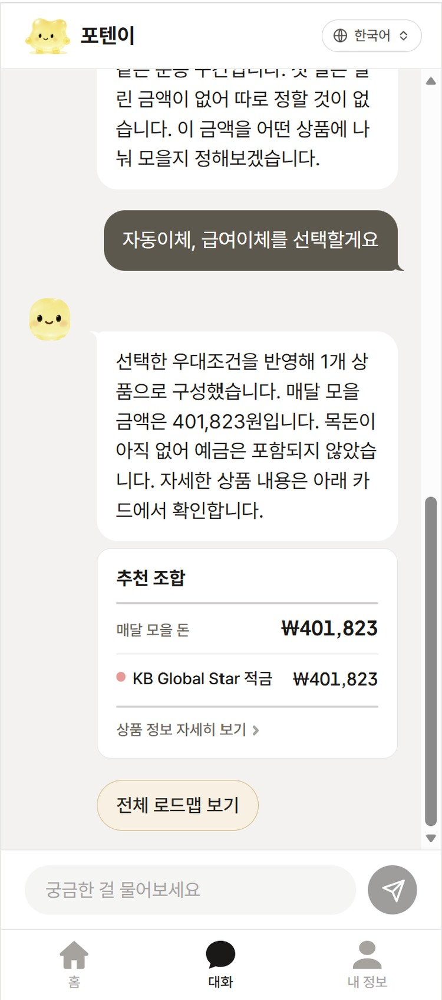
  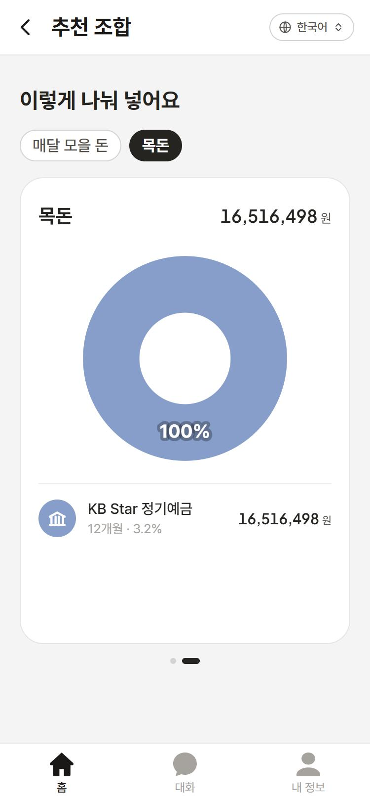
</p>

## 주요 기능

### 1. AI 상담 (포텐이)

- 저축·소비·환율·목표·로드맵 질문에 답변
- 답변과 함께 카드 표시 (로드맵 그래프 · 상품 추천 · 구간 상세 · 소비 요약)
- 말풍선별 한국어 ↔ 모국어 전환
- 다음 행동을 칩으로 제안
- E-9 송출국 17개국 언어 + 영어로 답변 번역 (화면 문구는 한국어 포함 19개 언어)

<p>
  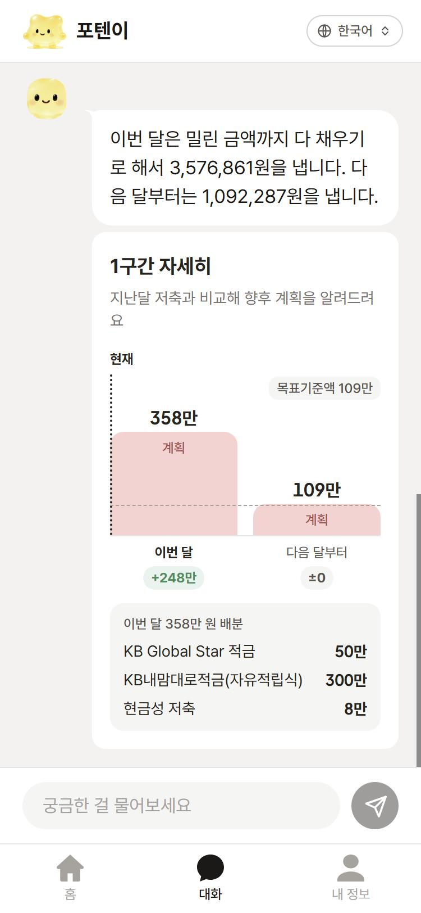
  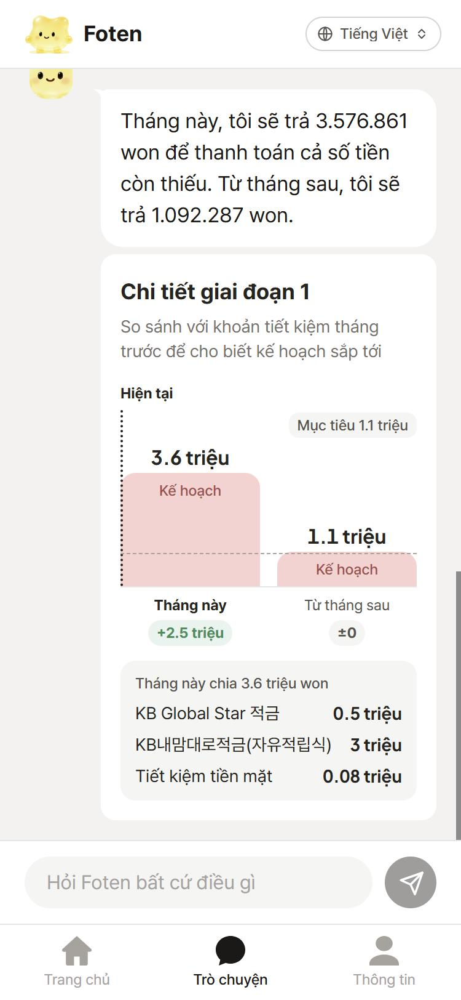
</p>

### 2. 귀국 목표 진단

- 온보딩 3단계 입력: 체류 정보 → 수입·지출 → 목표 금액
- 홈에서 D-day · 모은 돈 · 목표 달성률 표시
- 원화 / 본국 통화 동시 표시, 입력 칸별 단위 전환

<p>
  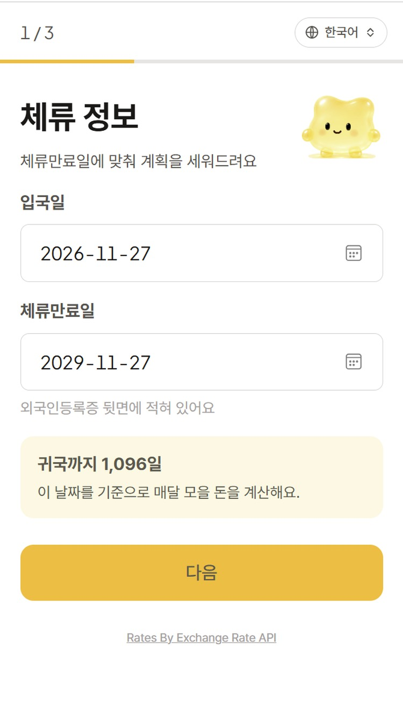
  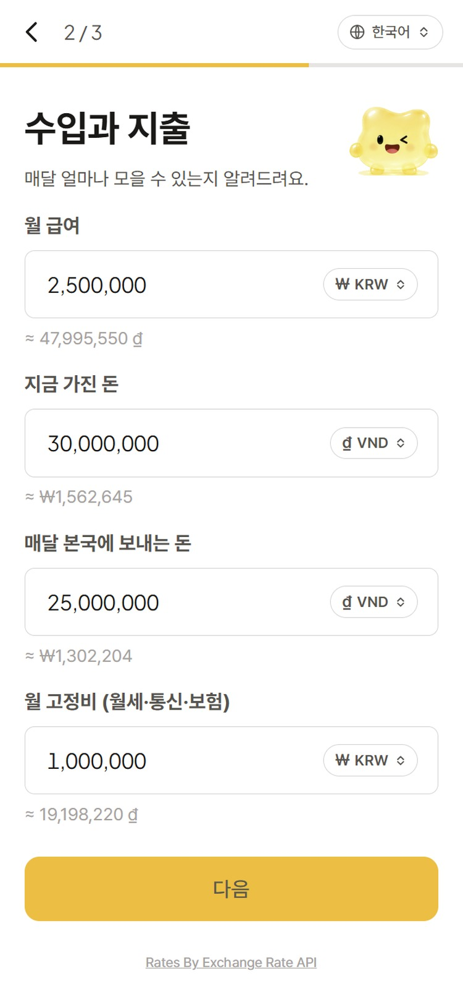
  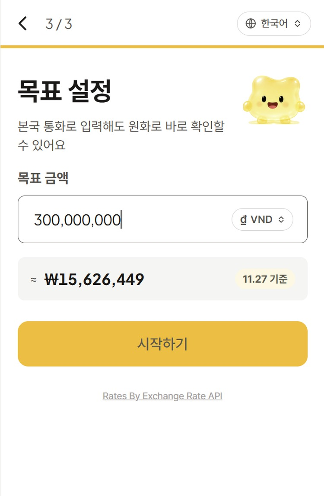
  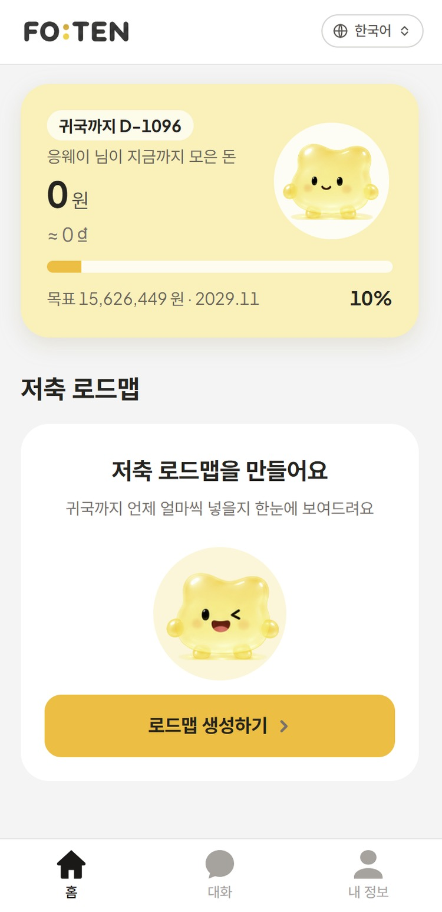
</p>

### 3. 저축 로드맵

- 귀국 1개월 전까지를 12개월 단위 구간으로 분할
- 매달 모을 돈: 적금 · 현금성 저축으로 배분
- 2구간부터: 직전 구간 만기금을 목돈으로 예금 가입
- 우대조건 체크 결과로 적용금리 계산 후 상품 선택
- 구간 기간을 지원하는 상품만 선택해 중도해지 방지

<p>
  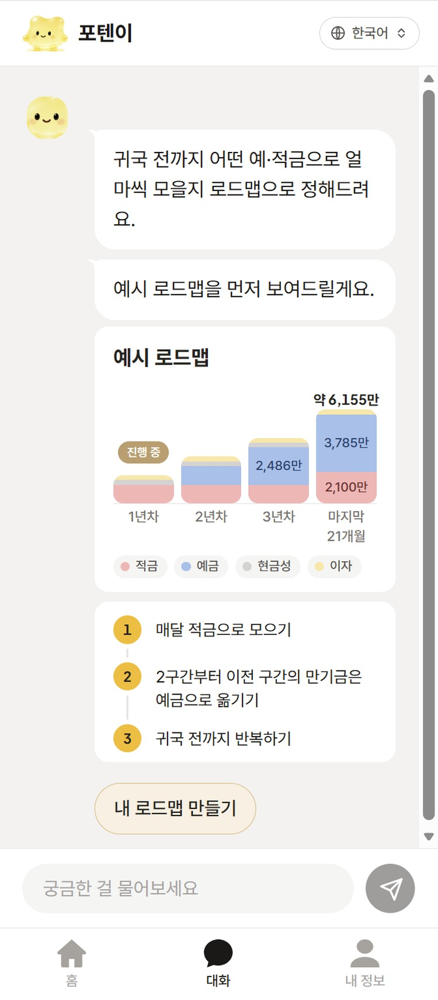
  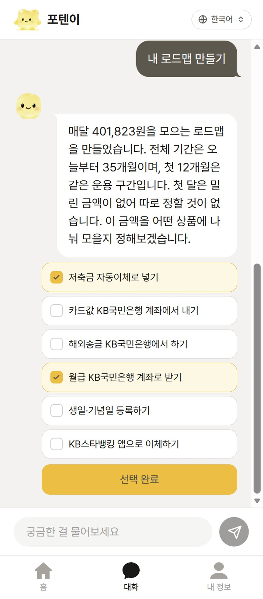
  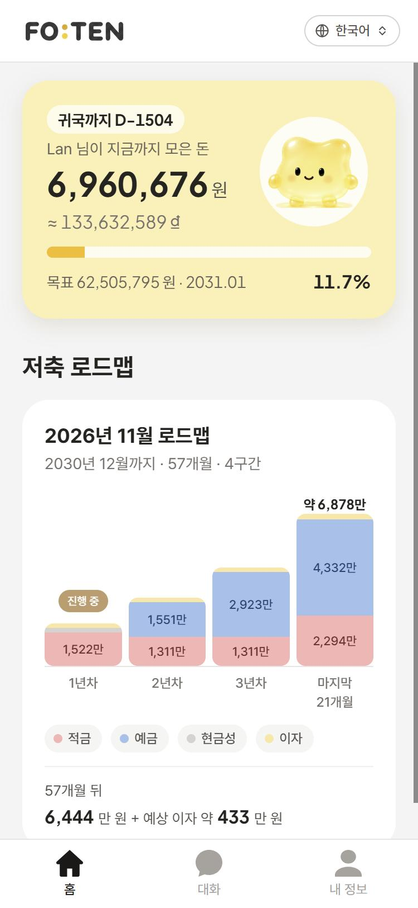
</p>

### 4. 월별 실적 점검

- 지난달 실적과 목표기준액 비교
- 이번 달 저축액 확정
- 부족액 발생 시 만회 방식 선택: 다음 달 한 번에 / 남은 기간에 나눠서
- 구간 종료 시 목돈을 다음 구간 예금으로 이월, 새 구간 상품 재선택

<p>
  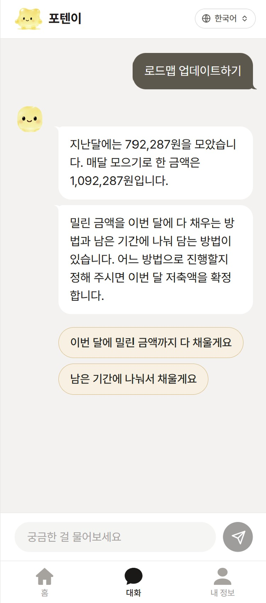
  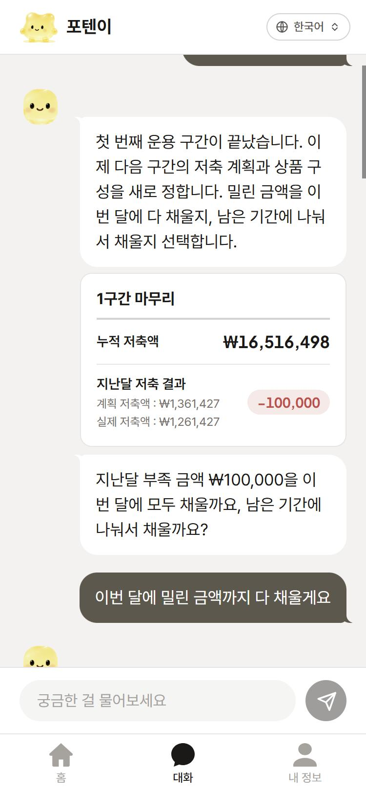
</p>

### 5. 소비 분석 · 상품 · 내 정보

- 최근 6개월 카테고리별 소비 (도넛 + 목록)
- 이번 달 예상 저축액 비교
  - 현재 예상 저축액: 지금 소비 속도를 유지할 때
  - 최대 예상 저축액: 최근 6개월 중 지출이 두 번째로 적은 달만큼 줄일 때
- 월 목표기준액과 비교해 3단계 판정: 여유있음 / 노력하면 가능 / 불가능
- "노력하면 가능"이면 절감 여력이 가장 큰 항목 안내
- 현재 구간 상품 구성 (매달 모을 돈 / 목돈 탭)
- 체류 · 재무 · 목표 정보 수정 (로드맵 시작 후 목표 변경 불가)

<p>
  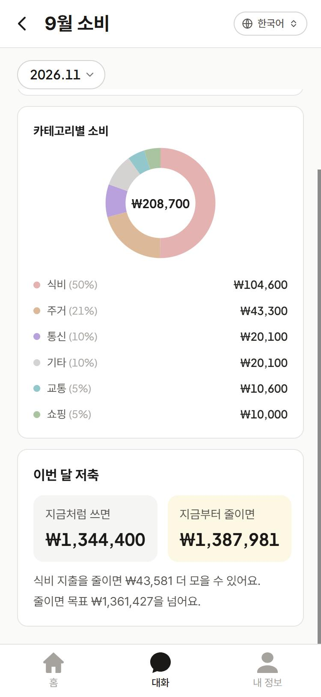
  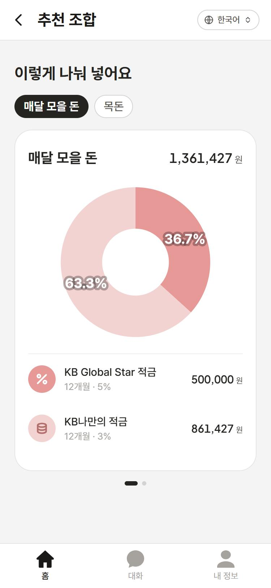
  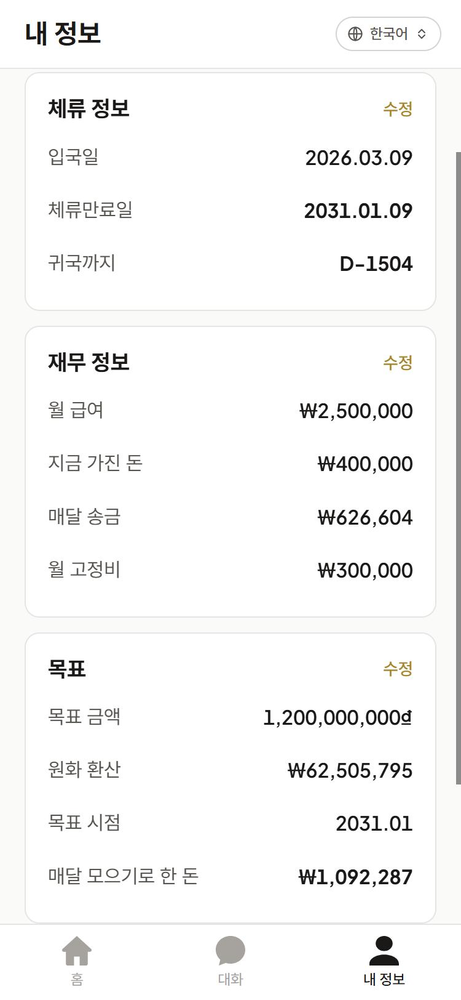
</p>

## 아키텍처

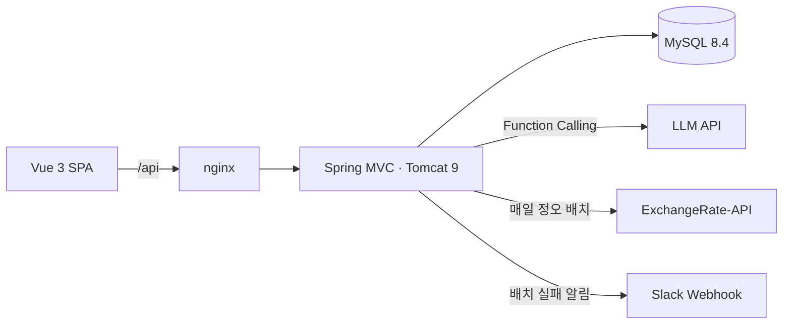

### AI 구조 (Function Calling)

- **계산은 Java, 문장은 LLM**: 금액·금리·날짜는 Java 계산 엔진 결과만 사용, LLM은 도구 선택과 문장 생성만 담당
- **시스템 프롬프트**: 원칙 12개 (숫자 · 답변 범위 · 안전 · 말투)
- **Advisor Chain**: 회원 상태와 최근 대화 10개를 맥락으로 주입
- **Tool Spec**: 도구 15개의 용도와 인자 형식을 JSON Schema로 고정
- **Tool Loop**: 도구 실행 결과를 LLM에 다시 전달, 왕복 최대 4회
- **변경 작업은 사용자 동의 후 실행**: 로드맵 생성 · 우대조건 제출 · 월 저축액 확정
- **카드는 생성 시점 스냅샷으로 저장**: 이력 재조회 시 재계산 없음

### 번역

- 답변은 한국어로만 생성, 다른 문자 체계가 섞이면 재작성 요청 후 남은 글자 제거
- 숫자를 자리표시자로 바꿔 번역 → 원문에 없는 자리표시자가 생기면 번역 폐기 → 현지 표기로 숫자 복원
- 번역 과정에서 금액이 바뀌지 않도록 숫자 무결성 보장

### 환율 배치

- 매일 12:00 ExchangeRate-API 수집, 서버 기동 15초 후 1회 추가 수집
- API 실패 시 5초 간격 최대 3회 재시도 → 실패하면 Slack 알림
- 일부 통화만 누락되면 나머지는 저장하고 누락 통화만 Slack 알림

<details>
<summary>대화 처리 흐름</summary>

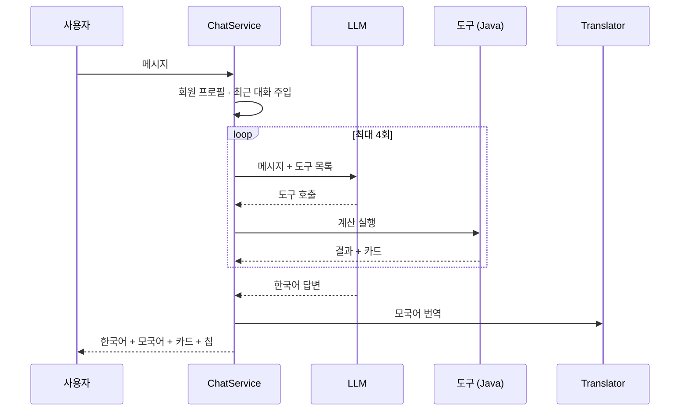

</details>

<details>
<summary>LLM 도구 15개</summary>

| 영역 | 도구 |
| --- | --- |
| 목표 | `diagnoseGoal` |
| 소비 | `getSpendingSummary` `getSpendingBreakdown` |
| 환율 | `getGoalAmountInKrw` `convertToKrw` `convertToLocalCurrency` |
| 로드맵 조회 | `getRoadmapStatus` `getSegmentComposition` `getMonthlyPlan` `getSegmentDetail` `getRoadmapGraph` `getPreferentialConditionQuestions` |
| 로드맵 변경 | `startRoadmap` `submitPreferentialConditions` `confirmMonthlySaving` |

</details>

## 로드맵 계산 규칙

| 항목 | 규칙 |
| --- | --- |
| 로드맵 기간 | 생성일 ~ 예상 귀국일 1개월 전 |
| 월 목표기준액 | (목표 금액 원화 - 온보딩 시 보유액) ÷ 남은 개월 (귀국월 제외, 최소 1개월) |
| 구간 분할 | 1구간: 전체 12개월 이하면 전체, 초과면 12개월 / 2구간부터: 잔여 24개월 이상이면 12개월, 미만이면 잔여 전체 |
| 적금 배분 | 구간 기간을 지원하는 자유적립식 적금을 적용금리 높은 순으로 월 납입한도까지 배분, 나머지는 현금성 저축 |
| 예금 (2구간부터) | 목돈 = 직전 구간 만기금(세후) + 현금성 잔액. 최소가입금액을 충족하는 예금 중 적용금리 최고 상품, 없으면 현금성 이월 |
| 적용금리 | min(최고금리, 기본금리 + 충족 예정 우대조건 가산금리) |
| 이자 | 단리 (적금은 회차별 납입액 기준), 이자소득세 15.4% 차감 |
| 부족액 | 목표기준액 × 지난 회차 - 누적 실적 (적금 납입 합계 + 최근 현금성 잔액) |
| 부족액 만회 | 한 번에: 목표기준액 + 부족액 / 나눠서: (목표 총액 - 현재 누적 자금) ÷ 남은 개월 |

## 기술 스택

| 구분 | 기술 |
| --- | --- |
| Frontend | Vue 3, Vite 5, Pinia, Vue Router, axios, Vitest |
| Backend | Java 17, Spring MVC 5.3, MyBatis 3.5, HikariCP, Gradle (WAR), Tomcat 9 |
| Database | MySQL 8.4 |
| AI | OpenAI GPT-5.6 Luna (Function Calling) |
| 외부 연동 | ExchangeRate-API (매일 정오 배치), Slack Incoming Webhook |
| 테스트 | JUnit 5, Mockito, Vitest |
| 인프라 | Docker Compose, nginx, GitHub Actions |

## 프로젝트 구조

```text
FO-TEN/
├─ BE/src/main/java/com/foten/
│  ├─ ai/          # 대화 · LLM · 도구 · 번역
│  ├─ goal/        # 목표 진단 · 저축 여력
│  ├─ product/     # 로드맵 · 우대조건 · 상품 배분
│  ├─ spending/    # 소비 집계
│  ├─ exchange/    # 환율 배치 · 환산
│  ├─ member/      # 회원 · 온보딩
│  └─ common/      # 예외 · 알림
├─ FE/src/
│  ├─ pages/       # 화면
│  ├─ components/  # 카드 · 차트 · 레이아웃
│  ├─ stores/      # Pinia
│  ├─ api/         # API 호출
│  └─ i18n/        # 19개 언어
├─ db/init/        # 스키마 · 시드 SQL
└─ docker-compose.yml
```

## 실행 방법

```bash
git clone https://github.com/FO-TEN/FO-TEN.git
cd FO-TEN
cp .env.example .env     # LLM_API_KEY, LLM_MODEL 입력
docker compose up -d     # http://localhost:5173
```

- 필요: Docker Desktop, LLM API 키
- 3306 포트 사용 중이면 로컬 MySQL 종료 후 실행
- 스키마 · 시드 변경 후에는 `docker compose down -v && docker compose up -d`

### 시연 계정

- 최초 실행 시 `db/init` 시드로 로컬 DB에 자동 생성
- 비밀번호 공통 `foten1234!`
- 실행일 기준으로 날짜가 맞춰져 언제 실행해도 같은 상황 재현

| 계정 | 상황 |
| --- | --- |
| `lin01` | 신규 가입, 온보딩 → 첫 로드맵 생성 |
| `lin02` | 7개월 차, 지난달 부족액 |
| `lin03` | 1구간 종료, 부족액 한 번에 만회 |
| `natty03` | 일반 월, 지난달 부족액 |
| `natty04` | 구간 전환 대기 |
| `natty05` | 구간 전환 대기 + 지난달 부족액 |

<details>
<summary>API 목록</summary>

| 메서드 | 경로 | 설명 |
| --- | --- | --- |
| POST | `/api/auth/register` `/login` `/logout` | 회원가입 · 로그인 · 로그아웃 |
| GET · POST | `/api/users/me/onboarding` | 온보딩 상태 · 등록 |
| GET | `/api/users/me` | 내 정보 |
| GET | `/api/goals/current/diagnosis` | 목표 진단 |
| GET | `/api/spending` | 월별 소비 |
| GET | `/api/exchange-rates/{code}` `/{code}/krw` | 환율 · 원화 환산 |
| GET · POST | `/api/rate-conditions` `/responses` | 우대조건 목록 · 응답 제출 |
| GET · POST | `/api/roadmap/status` `/api/roadmap` | 로드맵 상태 · 생성 |
| GET | `/api/roadmap/graph` | 로드맵 그래프 |
| GET | `/api/roadmap/segments/current/composition` `/detail` | 현재 구간 구성 · 상세 |
| GET · POST | `/api/roadmap/monthly-plan/current` `/deficit-choice` | 이번 달 계획 · 부족액 만회 방식 |
| POST · GET | `/api/chat` `/api/chat/messages` | 대화 · 이력 |

</details>

## 팀 세잎클로버

[@dltnalss](https://github.com/dltnalss) · [@SongMin21](https://github.com/SongMin21) · [@hz00308](https://github.com/hz00308)
